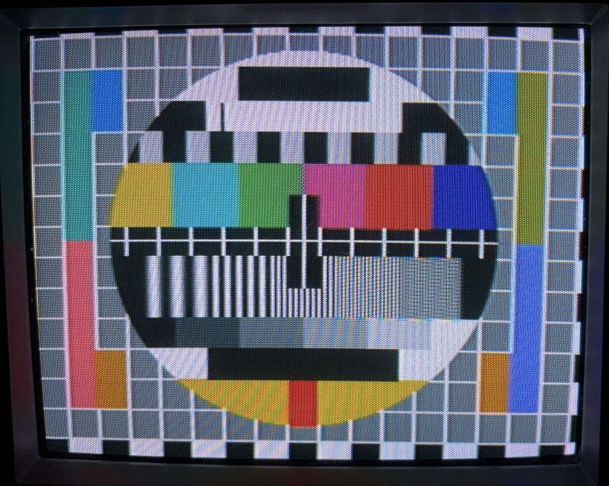
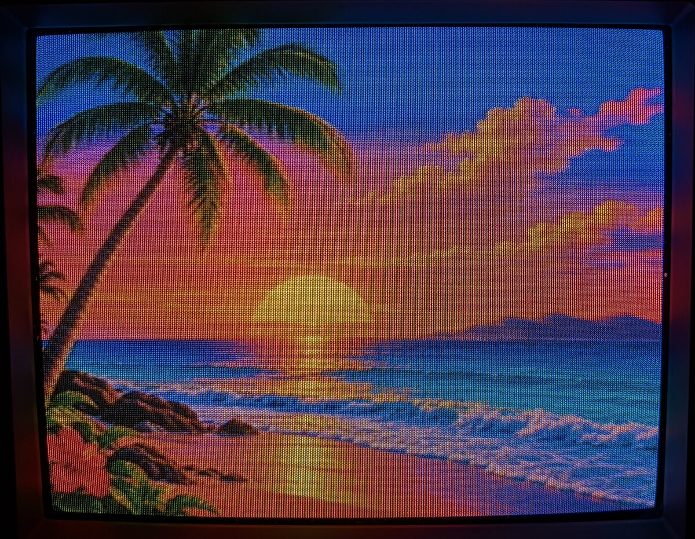
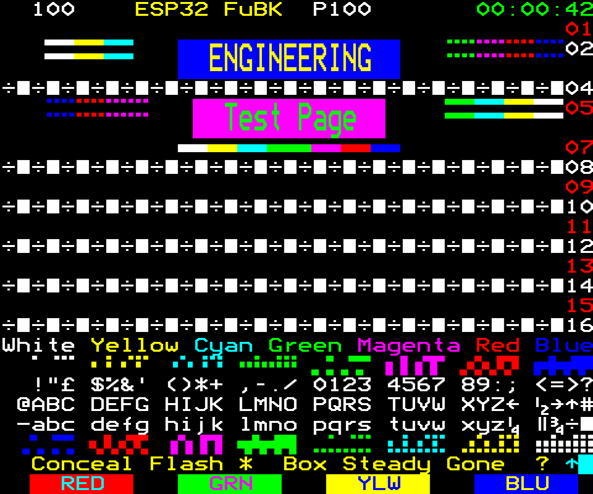

# ESP32 FuBK / PM5644 / SMPTE test pattern generator

<p align="center">
  
  
  
  
</p>
<p align="center"><em>From the ESP32, on a Panasonic CRT: PAL FuBK and NTSC PM5644 (top), NTSC SMPTE bars
and the non-interlaced 256-colour picture (bottom).</em></p>

Composite video test patterns from a plain ESP32 and one resistor:

- **PAL:** the German **FuBK** test card (Funkbetriebskommission). It is built from the original
  sample data of a ProTeleVision PT8631 generator, not drawn from a palette, so the circle,
  gratings, anti-PAL boxes and the 4.43 MHz orange patch are real.
- **PAL and NTSC:** the **Philips PM5644** colour circle, decoded from the EPROMs of real
  PM5644 generators (the PAL G00 and NTSC M00 units).
- **NTSC:** **SMPTE EG-1 colour bars**, with castellations, −I / white / +Q, and PLUGE.

One button switches between PAL and NTSC, and two LEDs show which one is on. PAL starts on FuBK,
NTSC on PM5644. A second button steps to the other test card (PAL: PM5644, NTSC: SMPTE bars)
and then through 15 more patterns: crosshatch, dots, circles, colour bars, greyscale with
PLUGE, purity fields, multiburst (also without colour burst), overscan markers, a white window,
and a non-interlaced 256-colour picture, as a home computer or game console sends. A 1 kHz test
tone, locked to the picture, comes out on another pin. PAL carries a teletext test page (P100), and NTSC
carries closed captions with a running clock. You can put your own text on the test cards
(two lines in the PM5644, the station name in FuBK) in the font of the Philips PM8503 text
generator; it is set with the two buttons.

The ESP32's internal 8-bit DAC sends samples at 20 MS/s. The colour subcarrier is calculated
for every sample, so the subcarrier frequency is exact and the 8-field PAL sequence (with the
25 Hz offset) is standard. The 20 MHz clock comes from the audio PLL with integer settings only,
so it has none of the sigma-delta clock jitter that makes slowly moving patterns on most ESP32
composite projects.

Tested on a Panasonic CRT, a 20-year-old plasma TV, a cheap reverse-camera monitor, a
RetroScaler 2X and a modern OLED TV's AV input. The ESP32's DAC shifts the colour of the picture
about 9° against the colour burst. The burst is turned back by the same amount (found by eye on
these screens). Without that, the anti-PAL boxes were not grey and the RetroScaler and the OLED
showed moving Hanover bars (horizontal colour stripes) on saturated colours.

## Hardware

Any board with the **original ESP32** works, for example a DevKitC, a LOLIN D32 or a WROOM-32
module. The ESP32-S2, -S3, -C3 and -C6 do not work: they have no I2S-to-DAC mode. Early ESP32
revisions (rev 0) also work, because the clock uses integer PLL settings only.

### Schematic

```
                      ESP32
              +---------------------+
              |                     |        110R              RCA (video, yellow)
              |       GPIO25 (DAC1) o-------/\/\/\---------------o  centre
              |                     |                            |
              |                 GND o----------------------------o  shield
              |                     |                       (TV: 75R to GND inside)
              |                     |
              |                     |   PAL/NTSC button
              |      GPIO4  ("D4")  o-------o  o------+
              |                     |                 |
              |                     |   pattern button|
              |      GPIO15 ("D15") o-------o  o------+
              |                     |                 |
              |                     |   330R    PAL   |
              |      GPIO12         o--/\/\/\---|>|---+
              |                     |                 |
              |                     |   330R    NTSC  |
              |      GPIO13         o--/\/\/\---|>|---+
              |                     |                 |
              |                 GND o-----------------+
              |                     |
              |                     |   3k3        10uF            RCA (audio)
              |      GPIO18         o--/\/\/\--+---||---+----------o  centre
              |                     |          |        |          |
              |                     |        ----     [10k]        |
              |                     |        ---- 10n   |          |
              |                     |          |        |          |
              |                 GND o----------+--------+----------o  shield
              +---------------------+
```

| Pin | Function |
|---|---|
| GPIO25 (DAC1) | Composite video. Use a **110 Ω series resistor** into the TV's 75 Ω (see below). |
| GPIO4 | Push button to GND (internal pull-up). Toggles PAL / NTSC; the choice is saved in flash and the board restarts. |
| GPIO15 | Push button to GND (internal pull-up). Next pattern; see [Use](#use). Not saved. GPIO15 is a strapping pin, but holding it at reset only silences the boot messages. |
| GPIO12 | LED: on in PAL. **Wire it as LED + resistor to GND** (the pin drives it high). GPIO12 is a strapping pin: anything that pulls it high at reset sets the wrong flash voltage and the board won't boot. |
| GPIO13 | LED: on in NTSC (LED + resistor to GND). |
| GPIO18 | 1 kHz sine as 312.5 kHz PWM. Filter it with an RC low-pass (3.3 kΩ + 10 nF) and a coupling capacitor. |

**Why 110 Ω:** the DAC swings 0 to about 3.3 V in 255 steps (about 12.9 mV each). With 110 Ω in
series and the TV's 75 Ω to ground, that becomes 3.3 V × 75 / 185 / 255 ≈ 5.2 mV per step. The
tables assume 5 mV per step, which gives 1 V from sync tip to white. If your picture is too dark
or too bright, adjust the resistor (100 to 120 Ω).

**Audio level:** the tone is about 3 V peak-to-peak before the filter, which is too hot for most
line inputs. Lower `AUDIO_AMP` in `esp32/firmware/main/main20.c` (40 gives about 1 V p-p), or add
a divider after the capacitor.

## Flashing

### Option A: prebuilt binary (no toolchain)

Download `fubk-esp32.bin` from the [Releases](../../releases) page. It is one merged image that
goes to address 0x0.

- **In the browser** (Chrome or Edge): open <https://espressif.github.io/esptool-js/>, click
  *Connect*, choose the board's serial port, set *Flash Address* to `0x0`, pick the file, then
  click *Program*.
- **From the command line** (`pip install esptool`):

  ```
  esptool.py --chip esp32 -p /dev/ttyUSB0 -b 460800 write_flash 0x0 fubk-esp32.bin
  ```

  On Windows the port is `COM3` or similar; on macOS it is `/dev/cu.usbserial-*`. Many boards
  need a CH340 or CP210x USB driver. If the connection fails, hold the BOOT button while it
  starts.

### Option B: build from source (ESP-IDF)

1. Install [ESP-IDF v5.5](https://docs.espressif.com/projects/esp-idf/en/stable/esp32/get-started/).
   The code was built and tested with v5.5.6.
2. Build and flash:

   ```
   . ~/esp/esp-idf-v5.5.6/export.sh          # Windows: use the "ESP-IDF" command prompt
   cd esp32/firmware
   idf.py set-target esp32
   idf.py -p /dev/ttyUSB0 flash monitor     # Ctrl-] leaves the monitor
   ```

   `sdkconfig.defaults` has everything the project needs (240 MHz CPU, and so on).
3. To make your own merged binary for a release:

   ```
   cd build && esptool.py --chip esp32 merge_bin -o ../fubk-esp32.bin @flash_args
   ```

### What the serial log should show

Every 2 s the firmware prints a status line:

```
fubk20: PAL | I2S flags (2 s): FIFO empty 0, TX hung 0, descriptor error 0; missed core0 0 core1 0, queue full 0; sample rate 20000000 Hz
fubk20: core 0: render 2 lines avg ... cycles = 41% / ...% of its time
fubk20: core 1: render 2 lines avg ... cycles = ...
```

`FIFO empty` and `missed` must stay at 0: anything else means the DMA ran dry and the picture will tear.
Average load is roughly 40 to 60 % per core.

## Use

Power the board and connect the video output to the TV. It starts in the standard it last used
(PAL the first time). Press the PAL/NTSC button to switch; the board restarts in the other
standard within a second.

It always starts with pattern 0: FuBK in PAL, PM5644 in NTSC. The pattern button steps through
the patterns below and back to pattern 0. The switch happens at a frame start, so the TV keeps
its sync. Before most patterns the screen is black for a few frames while the pattern is copied
from flash into RAM (only FuBK and the SMPTE bars stay in RAM all the time). The choice is not saved: after power-off it is pattern 0
again.


*All patterns as rendered from the pattern data (ideal pictures, not photos of a TV). 2–16 look
the same in PAL and NTSC; they differ in black level, PLUGE levels and multiburst frequencies.*

| # | Pattern | Use it for |
|---|---|---|
| 0 | PAL: FuBK. NTSC: Philips PM5644 | overall check, the reference |
| 1 | PAL: Philips PM5644. NTSC: SMPTE EG-1 bars | the other reference card |
| 2 | Crosshatch, 16 × 12 square cells, white on black | geometry, linearity, convergence. The middle lines are the centre cross; the outermost lines sit at the picture edge, so they show how much the TV crops. |
| 3 | Dots at the crosshatch crossings | static convergence, focus |
| 4 | Grey crosshatch with a large circle and four corner circles | linearity, aspect ratio (circles must be round) |
| 5 | Full-field colour bars 100/0/75/0 (white 100 %, colours 75 %) | colour, tint, decoder check |
| 6 | 11 grey steps (0–100 %) above PLUGE (PAL −2 % / +2 %, NTSC 3.5 / 11.5 IRE) and a white patch | brightness, contrast, greyscale tracking |
| 7–10 | White, red, green, blue fields (100 %) | purity, white balance, weak guns |
| 11 | Black field | brightness, raster glow, hum bars |
| 12 | Multiburst: white flag, then 60 % p-p bursts (PAL 0.5, 1, 2, 4, 4.8, 5.8 MHz; NTSC 0.5, 1.25, 2, 3, 3.58, 4.1 MHz) | sharpness, bandwidth, luma/chroma separation |
| 13 | Overscan markers: picture edge (white), 5 % action safe (75 % grey), 10 % title safe (50 % grey), centre cross | overscan, centring |
| 14 | White window, half width and height | high-voltage regulation, blooming, smearing |
| 15 | Multiburst as 12, without colour burst | the set's luma path on its own: most TVs switch to black and white and drop the colour notch |
| 16 | 256-colour picture, 320 pixels wide, **non-interlaced** (PAL 288 lines at 49.92 Hz, NTSC 240 lines at 60.06 Hz) | how a display handles "240p / 288p", as from game consoles and home computers |

All lines are white or grey, never thin coloured lines: composite colour only has about 1.3 MHz
of bandwidth, so thin red or blue lines smear. Horizontal lines are 2 picture lines thick (one in
each field), so they don't flicker on interlaced TVs. The list order is fixed: new patterns are
added at the end, so a number keeps its meaning (v1.3 inserted the second test card at 1, so
the older extra patterns moved up by one). Teletext and captions are off on pattern 16.

### Your own text on the test cards

The PM5644 has two black text boxes (8 and 12 characters), and FuBK has a name box at the top of
the circle (13 characters). They start empty, as on the plain cards. You can fill them with the
character set of the **Philips PM8503** text generator (the PM5644's text option): white 9 × 18
dot characters, each dot the size of 2 × 2 pixels of a 720-pixel picture.

The characters, in the order the buttons step through them:

```
(space) A-Z 0-9 ' % & ( ) + , - . : Ä Ö Ü Ø Æ À Á Â É È Ê Î Ï Ô Û Ñ ß (half space: only in the last place of a line)
```

**Setting the text:**

1. Pick the card with the standard: **PAL edits FuBK's name box, NTSC edits the PM5644 text.**
   (PAL's PM5644 shows the same text as NTSC's.) Switch to the standard you need first, in
   normal use.
2. **Hold both buttons while you power on** (or reset) the board, and let go. The card comes up
   with a blinking cursor on the first place. Pressing both buttons in normal use does nothing.
3. Change the text:

   | Buttons | Action |
   |---|---|
   | Pattern button | next character |
   | PAL/NTSC button | previous character |
   | Either one, held | repeats (after 0.5 s, 8 characters per second) |
   | Both, short press | next place (after the last place: back to the first) |
   | Both, held 1 s | previous place |

   In NTSC the places run through the upper line (8) and then the lower line (12).
4. **Saving is automatic:** 3 s after your last change, the picture blinks once (the board
   restarts to write the flash) and comes back in edit mode at the same place. After that
   blink, you can power off at any time; the text stays.
5. To leave edit mode, power off and on without holding the buttons.

**Tips:**

- **Centring:** a line with an odd number of free places can't be centred with spaces alone.
  The **half space** (only offered in the last place of a line, after ß) moves the whole line
  half a character to the right. For example, "YLE" in the upper PM5644 box: 2 spaces, YLE,
  2 spaces, half space.
- **FuBK's centre line:** the circle's vertical centre line runs through the middle (7th) place
  of the name box. A space there keeps the line: 3 spaces, "YLE", a space and "TV1" show as
  "YLE | TV1". Any other character in that place covers the line.
- Use the space to clear a place. The text is saved as a whole, so an empty box is just all
  spaces.

### Teletext (PAL) and closed captions (NTSC)

The vertical blanking carries data, with every pattern:

- **PAL: teletext page 100.** Press TEXT on the TV. The page is an engineering test page
  (colour bars, the full character set, double height, flash and conceal, a Fastext row). The
  header reads `ESP32 FuBK P100` with a clock that counts up from power-on. One packet goes out
  per field (lines 20 and 333), so the 25-row page repeats twice a second.
- **NTSC: closed captions CC1.** Turn on captions (CC1) on the TV. `NTSC TEST hh:mm:ss` appears
  on the bottom caption row and changes every second, the time counted from power-on. Line 21,
  field 1, pop-on captions.

<p align="center"></p>
<p align="center"><em>Page 100 as a basic (level 1) decoder shows it, with Reveal pressed. Rendered from
the transmitted page by <code>esp32/tools/render_teletext.py</code>, in the Bedstead teletext font.</em></p>

The teletext has been seen on a real TV. Newer decoders (teletext level 2.5, as in many later
TVs) show this test page differently, because it also tests codes that later levels
changed. That is the decoder, not missing data:
- **Red row numbers 01, 09, 11, 13, 15 missing:** those rows end in code 0, which level 1
  ignores but level 2.5 reads as "black text", so the numbers are black on black.
- **Row 2 and the bars at the top left look different:** the row uses "double size", which only
  newer decoders draw.
- **Row 23 shows only "Steady":** "Conceal" and "Gone" stay hidden until you press Reveal,
  "Flash" blinks, and "Box" only shows in subtitle or newsflash mode.
- **Row 24 shows the TV's own bar (for example "100 200 300 400"):** the set has Fastext or TOP.
  The page carries no Fastext links (packet 27), so such a TV fills the row with its own default
  links. A TV without Fastext shows the page's RED / GRN / YLW / BLU row, as in the picture above.
  So this row also tells you whether the set has Fastext.

The captions so far pass only the software decoder (`make -C esp32/host testvbi`); many TVs sold
outside North America have no caption decoder.

### What you should see

Set up a CRT in this order: brightness and contrast first (patterns 6 and 11), then colour
(0, 1 and 5), then geometry, convergence and focus (2, 3 and 4). Let the set warm up for
15–30 minutes before fine adjustments. Scalers and flat screens usually have no knobs. For them,
the patterns show what the device does with the signal.

**0 – FuBK (PAL)**
- The big circle is round, and the grid squares are equal.
- The gratings in the middle (1, 2 and 3 MHz) look like even vertical lines, not grey. The finest
  one shows the set's sharpness.
- The colour bars at the top have clean edges and no colour fringes around the grey areas.
- **Anti-PAL boxes** (the two boxes at the lower right, next to the colour ramps): their colour
  flips from line to line. A TV with a PAL delay line averages that away and shows them calm and
  nearly grey. A simple PAL decoder without one shows strong colour or horizontal stripes. That
  tells you which kind of decoder the set has, and it is not a fault.

**1 – SMPTE bars (NTSC)**
- Top: 75 % bars, in the order white, yellow, cyan, green, magenta, red, blue.
- Middle: a thin row of "castellations" with the bars in reverse order.
- Bottom: −I, white, +Q and black, then PLUGE at the bottom right.
- **Colour and tint:** if the set has a blue-only mode (or you look through a blue filter), adjust
  colour and tint until each blue bar matches the castellation just below it.

**PM5644 (NTSC 0, PAL 1)**
- The Philips colour circle. The grid and the black and white blocks around the edge show
  geometry and how much the TV crops; the circle must be round.
- Inside the circle, from the top: a black box (smearing or reflections show to its right), a row
  of black and white blocks, colour bars, a line with the centre cross, gratings from coarse to
  fine (sharpness), a greyscale, and a yellow / red strip at the bottom.
- The coloured bars at the left and right show colour at the picture edges.
- PAL is the pattern of the G00 unit (PAL-G), NTSC that of the M00 unit.

**6 – Greyscale and PLUGE**

```
 +----+----+----+----+----+----+----+----+----+----+----+
 | 0% |10% |20% |    ...                     |90% |100%|   11 grey steps
 |    |    |    |                            |    |    |
 +------+------+------+------+------+------+------------+
 |black | dark |black |bright|black |white |   black    |   PLUGE band
 |      | bar  |      | bar  |      |patch |            |
 +------+------+------+------+------+------+------------+
          PAL  -2 %     +2 %
          NTSC 3.5 IRE  11.5 IRE   (black is 7.5 IRE)
```

- **Brightness:** the dark bar is "blacker than black", the bright bar is just above black. Turn
  brightness up until you see both bars, then down until the **dark bar just disappears** into
  the black while the **bright bar stays faintly visible**. That is correct black level.
- **Contrast:** set it so the white patch and the 100 % step are bright but don't bloom (grow or
  go soft at the edges). All 11 grey steps should be distinct, including 0 % vs 10 % and 90 % vs
  100 %.
- **Greyscale tracking:** every step should be the same neutral grey. A coloured tint only in the
  dark steps points to the cut-off (bias) settings, and only in the bright steps to the drive
  (gain) settings.
- **On a scaler or flat screen:** most clip everything below black, so the dark bar never shows,
  which is normal. In NTSC many devices expect black at 0 IRE (Japan) instead of 7.5 IRE (USA).
  Then the black areas look dark grey and both bars show easily.
- **The PAL bars are faint on purpose:** ±2 % is 14 mV. The NTSC bars are twice as far from black
  (±4 IRE).

**2 – Crosshatch**
- All lines straight, and every cell the same size and square. Smaller cells at one side mean
  linearity is off.
- The centre cross (the middle vertical and horizontal line) sits in the middle of the tube.
- The outermost lines are the edge of the picture. On a CRT, they normally fall just outside the
  visible area (overscan).
- **Convergence:** the lines are pure white. Red, green or blue fringes beside a line mean the
  three beams don't meet there.

**3 – Dots**
- **Focus:** small, round, sharp dots, equally sharp in the centre and the corners.
- **Static convergence:** each dot is white in the centre of the screen, not three coloured dots
  side by side.

**4 – Circles**
- The large circle is round, not oval. If it is oval, the width or height is off.
- The four corner circles are round and all the same size; if not, linearity at the edges is off.

**5 – Colour bars 100/0/75/0**
- Order: white, yellow, cyan, green, magenta, red, blue, black.
- Turn colour down to zero: you should see an even staircase from bright to dark.
- In blue-only mode: cyan, magenta and blue look equally bright (white is brighter, because it is
  100 %). If they differ, adjust colour (saturation) and tint.

**7–10 – White, red, green and blue fields**
- **Purity:** each field is one even colour all over. Coloured blotches, usually near the corners,
  mean the tube needs degaussing or purity adjustment.
- **White:** the same neutral white everywhere, with no tint towards one side.

**11 – Black field**
- At correct brightness, the screen is black with no visible raster.
- Look for hum bars (slow-moving dark or light bands), retrace lines, and a glow at the edges.

**12 – Multiburst**
- Left: a white reference flag. Then six bursts of vertical stripes, from coarse to fine
  (PAL: 0.5, 1, 2, 4, 4.8, 5.8 MHz).
- **Sharpness:** with ideal bandwidth all bursts have the same contrast. The finer ones fade first.
  How far they stay visible shows the set's bandwidth.
- **Luma/chroma separation:** on composite, the bursts near the colour subcarrier (PAL 4 and
  4.8 MHz, NTSC 3 and 3.58 MHz) turn into colour patterns (cross-colour), more on simple
  decoders, less with a comb filter. Switching a scaler between its composite modes shows the
  difference clearly.

**13 – Overscan and safe areas**
- **White outline:** the edge of the active picture. A CRT normally hides it slightly.
- **75 % grey outline (5 % in):** "action safe". It should be visible on all four sides.
- **50 % grey outline (10 % in):** "title safe". It should always be well inside the screen.
- The small centre cross shows whether the picture is centred.

**14 – White window**
- The box keeps the same size and position when you switch to it from the black field. If the
  picture grows or breathes, the high-voltage regulation is weak.
- The edges are sharp. Smears or ghosts to the right of the box point to the video amplifier or
  to reflections in a long cable.

**15 – Multiburst without colour burst**
- The same picture as 12, but no line carries a colour burst. Most TVs then switch their colour
  decoder off and treat the signal as black and white; many also drop the notch filter at the
  colour subcarrier.
- Compare with 12: the fine bursts are often sharper here and show no colour patterns. That shows
  how much the set's luma/chroma separation costs in sharpness.

**16 – Non-interlaced 256-colour picture**
- Every field is the same, with whole lines only (PAL 313 lines, NTSC 262), so the two fields
  land on the same lines instead of between each other. Game consoles and home computers send
  this; a CRT shows it with visible gaps between the lines.
- The colour subcarrier is locked to the field, so the colour dot pattern stands still instead
  of crawling: NTSC repeats every field; PAL every second field (its V-switch flips per field).
  For that a few blanking-period and picture lines are 0.1 µs (PAL) or 0.5 µs (NTSC, one line)
  longer or shorter than normal.
- Many digital displays and scalers handle it badly: they treat it as interlaced and flicker or
  "bob" by a line, take a while to lock, show it softer, or don't show it at all. Switching to it
  from the test card shows how quickly a display follows.
- The picture is `data/picture.png` (any 4:3 image), 320 pixels wide like a home computer's. Its
  colour is softened as by a video encoder (brightness stays sharp), then reduced to 256 colours.
  Fine colourful detail (palm leaves, waves) still shows composite artifacts, more in NTSC.
- NTSC: every field is a whole number of colour subcarrier cycles (one blank line is 0.5 µs
  shorter), so the artifact pattern stands still as from a game console, instead of crawling.

## How it differs from the real patterns

These are good enough for adjusting and checking TVs, but they are not reference generators. The
main differences:

### Both standards

| | Real generator | This project |
|---|---|---|
| Frequency accuracy | Oven or TCXO reference; PAL fsc ±5 Hz, NTSC ±10 Hz | ESP32's 40 MHz crystal, typically ±10 ppm: fsc about ±44 Hz (PAL) / ±36 Hz (NTSC). TVs lock easily, but it fails a broadcast spec check. No genlock input. |
| Resolution | 10-bit (0.7 mV) | 8-bit DAC at 5 mV per step: 140 steps from black to white, so a slow ramp shows faint steps. |
| Level accuracy | Calibrated 1 V into 75 Ω | Depends on the 3.3 V supply and the resistor: about ±5 %. |
| Output impedance | 75 Ω (good return loss) | 110 Ω plus the DAC's own impedance: long cables can show slight reflections (ghosts). |
| Reconstruction filter | Yes | None. Each sample is held for 50 ns: chroma is 0.7 dB low at 4.43 MHz, but burst and colour drop by the same amount, so the TV's colour gain corrects it. Fine luma detail is about 1 dB low at 5 MHz. Image frequencies at 20 MHz − f are left in; TVs filter them out. |
| Vertical blanking | Optional test lines (VITS), teletext, WSS | One teletext line per field (PAL, one fixed page) or line-21 captions (NTSC). No VITS, WSS or VPS. |
| Audio | Usually on the RF carrier, or a separate balanced line output | A separate PWM pin, baseband only. |

### PAL FuBK

- **Data:** the PT8631's 13.5 MHz 4:2:2 samples (702 per line), resampled to 20 MHz with a
  6.2 MHz windowed sinc. Luma detail up to about 5.5 MHz is kept. Chroma is limited to about
  1.3 MHz, like a PAL encoder.
- **Date and time boxes removed:** the real card shows a station name, date and clock. Here those
  boxes are filled from the plain variant of the card. The name box can carry your own text
  (see [Your own text](#your-own-text-on-the-test-cards)), in the PM8503 font rather than the
  PT8631's own; there is no clock.
- **Anti-PAL boxes:** these are correct. The two data frames from the PT8631 alternate, so the
  boxes show grey on a PAL-D (delay-line) TV and colour on a simple PAL-S decoder.
- **Timing:** standard 625/50: 64.000 µs lines, 4.7 µs sync, 10-cycle burst at 135° / 225°, and
  exact fsc 4 433 618.75 Hz. In the samples the burst sits 9.1° early (126° / 216°): the ESP32
  DAC delays the picture's colour by about that much, so on the screen they match again. Burst
  amplitude is within 1 % and phase within 1° of nominal (8-bit rounding included). The SC-H
  phase (subcarrier to sync timing) is not set to a defined value.
- **Edges:** sync rise time is 250 ns (the standard allows 200 ± 100 ns).

### PM5644

- **Data:** the patterns of the PM5644G00 (PAL) and PM5644M00 (NTSC) EPROMs, 13.5 MHz 4:2:2,
  720 samples per line, resampled to 20 MHz like FuBK (luma up to about 5.5 MHz, chroma about
  1.3 MHz). A real PM5644 has its own encoder; here our sync, burst and colour encoding are used.
- **Only the stored pattern:** just the colour circle from the EPROMs is used, none of the
  generator's other functions.
- **NTSC:** 240 of the 243 pattern lines per field are shown (the active picture here is 480
  lines). The order of the two fields was chosen so that edges are smooth; the EPROMs do not
  say it directly.
- **Text:** the boxes take text in the PM8503 font, like a PM5644 with the text option, but the
  text position inside the boxes was chosen here (the capitals are centred, with room for the
  accents), not copied from a real unit. No other PM8503 functions (no clock, no scrolling).
- **Gratings:** the finest ones (PAL 3.8 and 4.8 MHz) lie near the colour subcarrier and turn
  into colour patterns on composite, as with a real PM5644.

### NTSC SMPTE bars

- **Line length:** 1271 samples = 63.55 µs instead of 63.5556 µs. The line rate is 15 735.6 Hz
  (+87 ppm) and the field rate is 59.945 Hz.
- **Subcarrier to line relation:** fsc is exactly 3 579 545.45 Hz, but a line is 227.48 cycles
  instead of 227.5. So the subcarrier drifts against sync (no fixed SC-H phase), there is no
  4-field colour sequence, and the chroma dots don't interleave perfectly from line to line.
  Mixing 1271- and 1272-sample lines to hit exactly 227.5 on average was tried: bar edges went
  wavy and a plasma TV showed snow, so it is off.
- **Bars:** EG-1 layout at 75 % amplitude with 7.5 IRE setup (NTSC-M as used in North America;
  Japanese NTSC-J has no setup). Bars fill the whole active line, 9.4 to 62.05 µs after the sync
  edge. Every area decodes within 3.3 mV (0.5 IRE) of the EG-1 values. Luma edges are 150 ns;
  chroma edges are 400 ns.
- **Burst:** 9 cycles, 40 IRE p-p at 180°.
- This is SMPTE EG-1 (SD analogue). It is not the HD bars of SMPTE RP 219.

## How it works (short)

- **Clock:** the APLL runs at 80 MHz (integer settings, so no jitter). I2S0 in DAC mode sends
  80 / 4 = 20 MS/s to DAC1.
- **Picture tables:** each line is built from 32-sample blocks of Y and U/V. A table only lists
  the blocks that change from one line to the next, so the whole FuBK card fits in 113 KB of
  internal RAM. No PSRAM is needed.
- **Colour:** each sample is `Y + (U·sin + V·cos)`, using one sine table read at a per-line
  offset that follows an exact free-running subcarrier phase. Flat colour areas (the NTSC bars)
  use precomputed waveforms.
- **Other patterns:** each has its own picture tables in flash (525 KB for all 32: the two
  pictures of pattern 16 and the two PM5644 cards are most of it) and shares the standard's
  sync, burst and carrier tables; patterns 15 and 16 bring their own line timing. The pattern
  on screen is copied into RAM first, because rendering from flash stalls on cache misses: a
  53 KB buffer, then heap blocks for what does not fit (PM5644 PAL: 90 KB). A switch takes
  effect at a frame start on both cores, and the subcarrier phase runs on unchanged.
- **Two cores:** the I2S interrupt on core 1 renders the odd buffers, and a task on core 0
  renders the even ones.
- **256-colour picture:** a colour signal `U·sin + V·cos` is the same as `A·sin(carrier + hue)`,
  so each palette colour stores its brightness, its saturation A and its hue as an offset into
  the sine table. Each sample is then one table read and one multiply. 4 pixels make 13 samples
  (3.25 per pixel). The picture is copied to RAM when selected (PAL 90 KB, in small blocks).
- **Teletext and captions:** the data lines are drawn sample by sample into blank lines
  (`vbi20.c`). Teletext bits are 320/111 samples long, so each sample is looked up from its
  position in the bit and the 5 nearest bits (raised-cosine pulses, no energy above 5.2 MHz). The
  packet, the header clock and the caption text all follow from the frame counter, so both cores
  agree without sharing anything.
- **Text:** after each line is rendered, the text dots are drawn over it. A dot is 80/27
  samples wide (2 pixels at 13.5 MHz, as on a PM8503) with 150 ns edges, so the letters stay
  within the video bandwidth; empty places are skipped quickly. The text is kept in NVS. Writing
  the flash can't happen while the video runs, so a save stops the video for a moment and
  restarts the board.
- **Tone:** the 1 kHz tone is stepped once per video line, so it is locked to the picture (PAL:
  exactly 40 cycles per frame).

Details, measurements and the experiments that were rejected are in
[`esp32/README.md`](esp32/README.md).

## Repository layout

```
esp32/firmware/          ESP-IDF project (main20.c, fubk_synth20.c, vbi20.c, generated tables *_tables.h)
esp32/tools/             make_tables20.py (pattern data -> C tables + exact model), patterns20.py
                         (the extra patterns), make_vbi20.py (teletext page, data pulse shapes),
                         pm5644.py (PM5644 EPROM dumps -> picture),
                         check20.py, check_vbi20.py (decodes the teletext / captions back),
                         check_prog20.py (decodes the non-interlaced picture page back),
                         render_teletext.py (docs/teletext-p100.png), pm8503_font.py (the text
                         font), check_text20.py (reads the card text back)
esp32/host/              PC test: the firmware's synthesis code == the Python model, byte for byte
ref/                     Python reference: PT8631 data loader, PAL encoder, software PAL decoder
data/fubk4x3.zip         PT8631 FuBK sample data, unchanged (read directly by the tools)
data/TEST25              the teletext test page, unchanged
data/picture.png         the picture of pattern 16 (AI-generated for this project)
data/pm8503_charset.png  the PM8503 character set, unchanged (read by tools/pm8503_font.py)
data/ptv_pm5644/         PM5644 EPROM dumps, downloaded by tools/pm5644.py (not in the repository)
```

The generated tables are checked in, so building the firmware needs only ESP-IDF.

### Regenerating and checking the tables (optional)

```
python3 -m venv venv && venv/bin/pip install -r requirements.txt
cd esp32
../venv/bin/python tools/pm5644.py                # downloads the PM5644 EPROM dumps (once)
../venv/bin/python tools/make_tables20.py          # writes firmware/main/*20_tables.h and out/
../venv/bin/python tools/make_tables20.py --test-field   # flat orange test field (used by the tests)
../venv/bin/python tools/preview_sheet.py         # docs/patterns.png from out/preview_*.png
../venv/bin/python tools/make_vbi20.py            # firmware/main/vbi20_tables.h from data/TEST25
../venv/bin/python tools/render_teletext.py       # docs/teletext-p100.png (downloads the Bedstead font once)
make -C host test20                                # C synthesis == model (PAL, NTSC, 2-core split,
                                                   # all patterns, pattern switching)
../venv/bin/python tools/check20.py out/model20_4frames.u8          # PAL: burst, chroma, anti-PAL
../venv/bin/python tools/check20.py --ntsc out/model20_ntsc_2frames.u8   # NTSC: bars vs EG-1
make -C host testvbi PY=../../venv/bin/python      # teletext / captions decoded back, other lines unchanged
make -C host testprog PY=../../venv/bin/python     # pattern 16 decoded back (sync, burst, every colour),
                                                   # pattern 15: no burst, otherwise = pattern 12
make -C host testtext PY=../../venv/bin/python     # the card text read back from the output
```

### Older 4×fsc build

`idf.py -DFUBK_20MHZ=0 build` selects the first design: PAL only, 17.73 MS/s from a fractional
APLL. Its clock jitter makes slowly moving patterns. It is kept for comparison; see
`esp32/README.md`.

## Credits

- **FuBK pattern data:** the FuBK test card as stored in the **ProTeleVision PT8631** test
  pattern generator board (used in the PT5230 generator; ProTeleVision Technologies, Denmark,
  formerly Philips TV test equipment). The original pattern is by ProTeleVision. The data files,
  `PT5230/PT8631/TPD/BILLEDDATA/FUBK4X3` (the `ANTIPAL` set and the plain set), are preserved
  in Karsten Hervø Hansen's [KarstenHervoeHansen/PTV](https://github.com/KarstenHervoeHansen/PTV)
  repository. `data/fubk4x3.zip` holds those files unchanged (`FUBK4X3/ANTIPAL/` and
  `FUBK4X3/`). The tools turn them into the tables in `esp32/firmware/main/fubk20_tables.h`.
- **PM5644 pattern data:** the colour circle of the **Philips PM5644** colour pattern generator
  (Philips, later ProTeleVision). The EPROM dumps of the PM5644G00 (PAL) and PM5644M00 (NTSC)
  units are preserved in Matthew Millman's (inaxeon)
  [inaxeon/PTV_Preservation](https://github.com/inaxeon/PTV_Preservation) repository. They are not
  copied here: `esp32/tools/pm5644.py` downloads them (at a fixed commit, checksums checked) and
  decodes them; the tables made from them are checked in (`esp32/firmware/main/patterns20_tables.h`,
  arrays `f20p01_*` and `n20p00_*`).
- **Teletext test page:** `TEST25` from the teletext sample pages at
  [mdfs.net](https://mdfs.net/System/Teletext/Samples/), unchanged in `data/TEST25`; its header
  row is replaced by our own. The page picture uses Ben Harris's
  [Bedstead](https://bjh21.me.uk/bedstead/) font (CC0), drawn after the SAA5050 teletext
  character generator; `render_teletext.py` downloads it (not in the repository).
- **Text font:** the character set of the **Philips PM8503** text generator, from the image
  ["Aliased character set of the PM8503"](https://commons.wikimedia.org/wiki/File:Aliased_character_set_of_the_PM8503.png)
  by Inaxeon on Wikimedia Commons (CC0), drawn from the PM8503's character PROMs
  (4008-102-51330 and 4008-102-51340). It is in `data/pm8503_charset.png` unchanged; the
  apostrophe is the set's acute accent.
- Ideas and ESP32 I2S/DAC setup:
  - [rossumur/esp_8_bit](https://github.com/rossumur/esp_8_bit)
  - [bitluni/ESP32CompositeVideo](https://github.com/bitluni/ESP32CompositeVideo)
  - [marciot/ESP32CompositeColorVideo](https://github.com/marciot/ESP32CompositeColorVideo)
  - [nmur/ESP32-TestPatternGenerator](https://github.com/nmur/ESP32-TestPatternGenerator): the
    panel layout (button, LEDs, tone) follows a box built on it.
- SMPTE EG-1 colour bars, ITU-R BT.470 / BT.1700 for the PAL and NTSC timing.

## License

The code, tools and documentation of this project are released into the public domain under
[CC0 1.0 Universal](LICENSE). You can copy, modify and use them for anything, without asking.

This does **not** cover third-party material, which stays with its owners:
- the PT8631 FuBK pattern data, both in `data/fubk4x3.zip` and in the tables generated from it
  (`esp32/firmware/main/fubk*_tables*.h`)
- the PM5644 pattern data, in the tables generated from it (`esp32/firmware/main/patterns20_tables.h`:
  the arrays `f20p01_*` and `n20p00_*`)
- the teletext test page `data/TEST25` and the page data generated from it
  (`esp32/firmware/main/vbi20_tables.h`)

See [Credits](#credits) for where it comes from.
