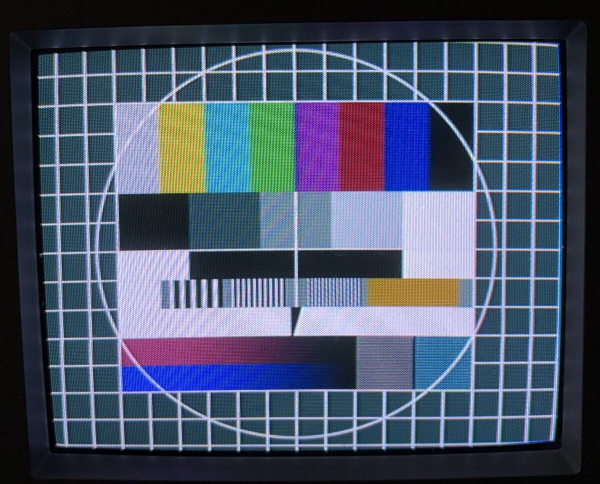
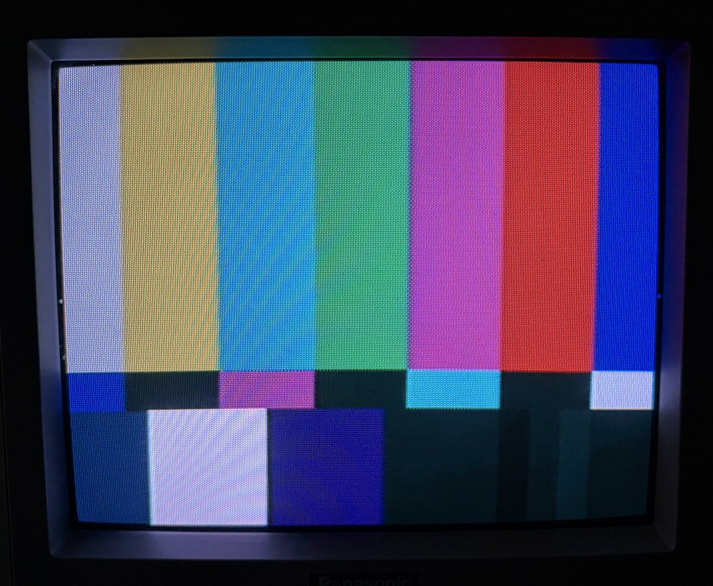
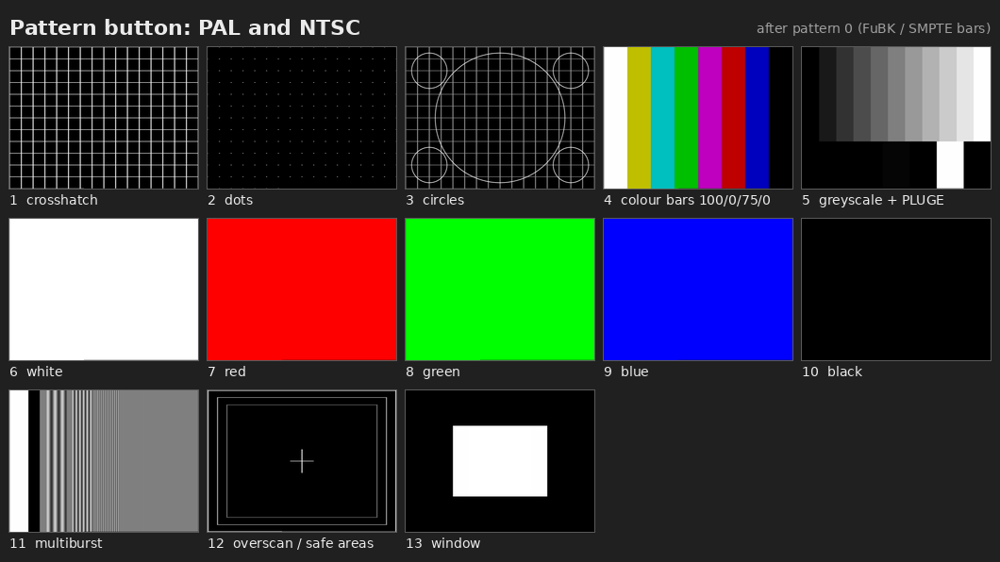

# ESP32 FuBK / SMPTE test pattern generator

<p align="center">
  
  
</p>
<p align="center"><em>PAL FuBK (left) and NTSC SMPTE bars (right) from the ESP32, on a Panasonic CRT.</em></p>

Composite video test patterns from a plain ESP32 and one resistor:

- **PAL:** the German **FuBK** test card (Funkbetriebskommission). It is built from the original
  sample data of a ProTeleVision PT8631 generator, not drawn from a palette, so the circle,
  gratings, anti-PAL boxes and the 4.43 MHz orange patch are real.
- **NTSC:** **SMPTE EG-1 colour bars**, with castellations, −I / white / +Q, and PLUGE.

One button switches between them, and two LEDs show which one is on. A second button steps
through 13 everyday calibration patterns: crosshatch, dots, circles, colour bars, greyscale with
PLUGE, purity fields, multiburst, overscan markers and a white window. A 1 kHz test tone, locked
to the picture, comes out on another pin.

The ESP32's internal 8-bit DAC sends samples at 20 MS/s. The colour subcarrier is calculated
for every sample, so the subcarrier frequency is exact and the 8-field PAL sequence (with the
25 Hz offset) is standard. The 20 MHz clock comes from the audio PLL with integer settings only,
so it has none of the sigma-delta clock jitter that makes slowly moving patterns on most ESP32
composite projects.

Tested on a Panasonic CRT, a 20-year-old plasma TV, a cheap reverse-camera monitor and a
RetroScaler 2X.

## Hardware

Any board with the **original ESP32** works, for example a DevKitC, a LOLIN D32 or a WROOM-32
module. The ESP32-S2, -S3, -C3 and -C6 do not work: they have no I2S-to-DAC mode. Early ESP32
revisions (rev 0) also work, because the clock uses integer PLL settings only.

### Schematic

```
                      ESP32
              +---------------------+
              |                     |        110R              RCA (video, yellow)
              |       GPIO25 (DAC1) o-------/\/\/\---------------o  centre
              |                     |                            |
              |                 GND o----------------------------o  shield
              |                     |                       (TV: 75R to GND inside)
              |                     |
              |                     |   PAL/NTSC button
              |      GPIO4  ("D4")  o-------o  o------+
              |                     |                 |
              |                     |   pattern button|
              |      GPIO15 ("D15") o-------o  o------+
              |                     |                 |
              |                     |   330R    PAL   |
              |      GPIO12         o--/\/\/\---|>|---+
              |                     |                 |
              |                     |   330R    NTSC  |
              |      GPIO13         o--/\/\/\---|>|---+
              |                     |                 |
              |                 GND o-----------------+
              |                     |
              |                     |   3k3        10uF            RCA (audio)
              |      GPIO18         o--/\/\/\--+---||---+----------o  centre
              |                     |          |        |          |
              |                     |        ----     [10k]        |
              |                     |        ---- 10n   |          |
              |                     |          |        |          |
              |                 GND o----------+--------+----------o  shield
              +---------------------+
```

| Pin | Function |
|---|---|
| GPIO25 (DAC1) | Composite video. Use a **110 Ω series resistor** into the TV's 75 Ω (see below). |
| GPIO4 | Push button to GND (internal pull-up). Toggles PAL / NTSC; the choice is saved in flash and the board restarts. |
| GPIO15 | Push button to GND (internal pull-up). Next pattern; see [Use](#use). Not saved. GPIO15 is a strapping pin, but holding it at reset only silences the boot messages. |
| GPIO12 | LED: on in PAL. **Wire it as LED + resistor to GND** (the pin drives it high). GPIO12 is a strapping pin: anything that pulls it high at reset sets the wrong flash voltage and the board won't boot. |
| GPIO13 | LED: on in NTSC (LED + resistor to GND). |
| GPIO18 | 1 kHz sine as 312.5 kHz PWM. Filter it with an RC low-pass (3.3 kΩ + 10 nF) and a coupling capacitor. |

**Why 110 Ω:** the DAC swings 0 to about 3.3 V in 255 steps (about 12.9 mV each). With 110 Ω in
series and the TV's 75 Ω to ground, that becomes 3.3 V × 75 / 185 / 255 ≈ 5.2 mV per step. The
tables assume 5 mV per step, which gives 1 V from sync tip to white. If your picture is too dark
or too bright, adjust the resistor (100 to 120 Ω).

**Audio level:** the tone is about 3 V peak-to-peak before the filter, which is too hot for most
line inputs. Lower `AUDIO_AMP` in `esp32/firmware/main/main20.c` (40 gives about 1 V p-p), or add
a divider after the capacitor.

## Flashing

### Option A: prebuilt binary (no toolchain)

Download `fubk-esp32.bin` from the [Releases](../../releases) page. It is one merged image that
goes to address 0x0.

- **In the browser** (Chrome or Edge): open <https://espressif.github.io/esptool-js/>, click
  *Connect*, choose the board's serial port, set *Flash Address* to `0x0`, pick the file, then
  click *Program*.
- **From the command line** (`pip install esptool`):

  ```
  esptool.py --chip esp32 -p /dev/ttyUSB0 -b 460800 write_flash 0x0 fubk-esp32.bin
  ```

  On Windows the port is `COM3` or similar; on macOS it is `/dev/cu.usbserial-*`. Many boards
  need a CH340 or CP210x USB driver. If the connection fails, hold the BOOT button while it
  starts.

### Option B: build from source (ESP-IDF)

1. Install [ESP-IDF v5.5](https://docs.espressif.com/projects/esp-idf/en/stable/esp32/get-started/).
   The code was built and tested with v5.5.6.
2. Build and flash:

   ```
   . ~/esp/esp-idf-v5.5.6/export.sh          # Windows: use the "ESP-IDF" command prompt
   cd esp32/firmware
   idf.py set-target esp32
   idf.py -p /dev/ttyUSB0 flash monitor     # Ctrl-] leaves the monitor
   ```

   `sdkconfig.defaults` has everything the project needs (240 MHz CPU, and so on).
3. To make your own merged binary for a release:

   ```
   cd build && esptool.py --chip esp32 merge_bin -o ../fubk-esp32.bin @flash_args
   ```

### What the serial log should show

Every 2 s the firmware prints a status line:

```
fubk20: PAL | I2S flags (2 s): FIFO empty 0, TX hung 0, descriptor error 0; missed core0 0 core1 0, queue full 0; sample rate 20000000 Hz
fubk20: core 0: render 2 lines avg ... cycles = 41% / ...% of its time
fubk20: core 1: render 2 lines avg ... cycles = ...
```

`FIFO empty` and `missed` must stay at 0: anything else means the DMA ran dry and the picture will tear.
Average load is roughly 40 to 60 % per core.

## Use

Power the board and connect the video output to the TV. It starts in the standard it last used
(PAL the first time). Press the PAL/NTSC button to switch; the board restarts in the other
standard within a second.

It always starts with the real test card: FuBK in PAL, SMPTE bars in NTSC. The pattern button
steps through the patterns below and back to the test card. The switch happens at a frame
start, so the TV keeps its sync. Between two extra patterns the screen is black for a few frames
while the next one is copied into RAM. The choice is not saved: after power-off it is the test card
again.



*The extra patterns as rendered from the pattern data (ideal pictures, not photos of a TV). PAL
and NTSC look the same; they differ in black level, PLUGE levels and multiburst frequencies.*

| # | Pattern | Use it for |
|---|---|---|
| 0 | FuBK (PAL) / SMPTE EG-1 bars (NTSC) | overall check, the reference |
| 1 | Crosshatch, 16 × 12 square cells, white on black | geometry, linearity, convergence. The middle lines are the centre cross; the outermost lines sit at the picture edge, so they show how much the TV crops. |
| 2 | Dots at the crosshatch crossings | static convergence, focus |
| 3 | Grey crosshatch with a large circle and four corner circles | linearity, aspect ratio (circles must be round) |
| 4 | Full-field colour bars 100/0/75/0 (white 100 %, colours 75 %) | colour, tint, decoder check |
| 5 | 11 grey steps (0–100 %) above PLUGE (PAL −2 % / +2 %, NTSC 3.5 / 11.5 IRE) and a white patch | brightness, contrast, greyscale tracking |
| 6–9 | White, red, green, blue fields (100 %) | purity, white balance, weak guns |
| 10 | Black field | brightness, raster glow, hum bars |
| 11 | Multiburst: white flag, then 60 % p-p bursts (PAL 0.5, 1, 2, 4, 4.8, 5.8 MHz; NTSC 0.5, 1.25, 2, 3, 3.58, 4.1 MHz) | sharpness, bandwidth, luma/chroma separation |
| 12 | Overscan markers: picture edge (white), 5 % action safe (75 % grey), 10 % title safe (50 % grey), centre cross | overscan, centring |
| 13 | White window, half width and height | high-voltage regulation, blooming, smearing |

All lines are white or grey, never thin coloured lines: composite colour only has about 1.3 MHz
of bandwidth, so thin red or blue lines smear. Horizontal lines are 2 picture lines thick (one in
each field), so they don't flicker on interlaced TVs. The list order is fixed: new patterns are
added at the end, so a number always means the same pattern.

### What you should see

Set up a CRT in this order: brightness and contrast first (patterns 5 and 10), then colour
(0 and 4), then geometry, convergence and focus (1, 2 and 3). Let the set warm up for
15–30 minutes before fine adjustments. Scalers and flat screens usually have no knobs. For them,
the patterns show what the device does with the signal.

**0 – FuBK (PAL)**
- The big circle is round, and the grid squares are equal.
- The gratings in the middle (1, 2 and 3 MHz) look like even vertical lines, not grey. The finest
  one shows the set's sharpness.
- The colour bars at the top have clean edges and no colour fringes around the grey areas.
- **Anti-PAL boxes** (the two boxes at the lower right, next to the colour ramps): their colour
  flips from line to line. A TV with a PAL delay line averages that away and shows them calm and
  nearly grey. A simple PAL decoder without one shows strong colour or horizontal stripes. That
  tells you which kind of decoder the set has, and it is not a fault.

**0 – SMPTE bars (NTSC)**
- Top: 75 % bars, in the order white, yellow, cyan, green, magenta, red, blue.
- Middle: a thin row of "castellations" with the bars in reverse order.
- Bottom: −I, white, +Q and black, then PLUGE at the bottom right.
- **Colour and tint:** if the set has a blue-only mode (or you look through a blue filter), adjust
  colour and tint until each blue bar matches the castellation just below it.

**5 – Greyscale and PLUGE**

```
 +----+----+----+----+----+----+----+----+----+----+----+
 | 0% |10% |20% |    ...                     |90% |100%|   11 grey steps
 |    |    |    |                            |    |    |
 +------+------+------+------+------+------+------------+
 |black | dark |black |bright|black |white |   black    |   PLUGE band
 |      | bar  |      | bar  |      |patch |            |
 +------+------+------+------+------+------+------------+
          PAL  -2 %     +2 %
          NTSC 3.5 IRE  11.5 IRE   (black is 7.5 IRE)
```

- **Brightness:** the dark bar is "blacker than black", the bright bar is just above black. Turn
  brightness up until you see both bars, then down until the **dark bar just disappears** into
  the black while the **bright bar stays faintly visible**. That is correct black level.
- **Contrast:** set it so the white patch and the 100 % step are bright but don't bloom (grow or
  go soft at the edges). All 11 grey steps should be distinct, including 0 % vs 10 % and 90 % vs
  100 %.
- **Greyscale tracking:** every step should be the same neutral grey. A coloured tint only in the
  dark steps points to the cut-off (bias) settings, and only in the bright steps to the drive
  (gain) settings.
- **On a scaler or flat screen:** most clip everything below black, so the dark bar never shows,
  which is normal. In NTSC many devices expect black at 0 IRE (Japan) instead of 7.5 IRE (USA).
  Then the black areas look dark grey and both bars show easily.
- **The PAL bars are faint on purpose:** ±2 % is 14 mV. The NTSC bars are twice as far from black
  (±4 IRE).

**1 – Crosshatch**
- All lines straight, and every cell the same size and square. Smaller cells at one side mean
  linearity is off.
- The centre cross (the middle vertical and horizontal line) sits in the middle of the tube.
- The outermost lines are the edge of the picture. On a CRT, they normally fall just outside the
  visible area (overscan).
- **Convergence:** the lines are pure white. Red, green or blue fringes beside a line mean the
  three beams don't meet there.

**2 – Dots**
- **Focus:** small, round, sharp dots, equally sharp in the centre and the corners.
- **Static convergence:** each dot is white in the centre of the screen, not three coloured dots
  side by side.

**3 – Circles**
- The large circle is round, not oval. If it is oval, the width or height is off.
- The four corner circles are round and all the same size; if not, linearity at the edges is off.

**4 – Colour bars 100/0/75/0**
- Order: white, yellow, cyan, green, magenta, red, blue, black.
- Turn colour down to zero: you should see an even staircase from bright to dark.
- In blue-only mode: cyan, magenta and blue look equally bright (white is brighter, because it is
  100 %). If they differ, adjust colour (saturation) and tint.

**6–9 – White, red, green and blue fields**
- **Purity:** each field is one even colour all over. Coloured blotches, usually near the corners,
  mean the tube needs degaussing or purity adjustment.
- **White:** the same neutral white everywhere, with no tint towards one side.

**10 – Black field**
- At correct brightness, the screen is black with no visible raster.
- Look for hum bars (slow-moving dark or light bands), retrace lines, and a glow at the edges.

**11 – Multiburst**
- Left: a white reference flag. Then six bursts of vertical stripes, from coarse to fine
  (PAL: 0.5, 1, 2, 4, 4.8, 5.8 MHz).
- **Sharpness:** with ideal bandwidth all bursts have the same contrast. The finer ones fade first.
  How far they stay visible shows the set's bandwidth.
- **Luma/chroma separation:** on composite, the bursts near the colour subcarrier (PAL 4 and
  4.8 MHz, NTSC 3 and 3.58 MHz) turn into colour patterns (cross-colour), more on simple
  decoders, less with a comb filter. Switching a scaler between its composite modes shows the
  difference clearly.

**12 – Overscan and safe areas**
- **White outline:** the edge of the active picture. A CRT normally hides it slightly.
- **75 % grey outline (5 % in):** "action safe". It should be visible on all four sides.
- **50 % grey outline (10 % in):** "title safe". It should always be well inside the screen.
- The small centre cross shows whether the picture is centred.

**13 – White window**
- The box keeps the same size and position when you switch to it from the black field. If the
  picture grows or breathes, the high-voltage regulation is weak.
- The edges are sharp. Smears or ghosts to the right of the box point to the video amplifier or
  to reflections in a long cable.

## How it differs from the real patterns

These are good enough for adjusting and checking TVs, but they are not reference generators. The
main differences:

### Both standards

| | Real generator | This project |
|---|---|---|
| Frequency accuracy | Oven or TCXO reference; PAL fsc ±5 Hz, NTSC ±10 Hz | ESP32's 40 MHz crystal, typically ±10 ppm: fsc about ±44 Hz (PAL) / ±36 Hz (NTSC). TVs lock easily, but it fails a broadcast spec check. No genlock input. |
| Resolution | 10-bit (0.7 mV) | 8-bit DAC at 5 mV per step: 140 steps from black to white, so a slow ramp shows faint steps. |
| Level accuracy | Calibrated 1 V into 75 Ω | Depends on the 3.3 V supply and the resistor: about ±5 %. |
| Output impedance | 75 Ω (good return loss) | 110 Ω plus the DAC's own impedance: long cables can show slight reflections (ghosts). |
| Reconstruction filter | Yes | None. Each sample is held for 50 ns: chroma is 0.7 dB low at 4.43 MHz, but burst and colour drop by the same amount, so the TV's colour gain corrects it. Fine luma detail is about 1 dB low at 5 MHz. Image frequencies at 20 MHz − f are left in; TVs filter them out. |
| Vertical blanking | Optional test lines (VITS), teletext, WSS | Empty, black. |
| Audio | Usually on the RF carrier, or a separate balanced line output | A separate PWM pin, baseband only. |

### PAL FuBK

- **Data:** the PT8631's 13.5 MHz 4:2:2 samples (702 per line), resampled to 20 MHz with a
  6.2 MHz windowed sinc. Luma detail up to about 5.5 MHz is kept. Chroma is limited to about
  1.3 MHz, like a PAL encoder.
- **Date and time boxes removed:** the real card shows a station name, date and clock. Here those
  boxes are filled from the plain variant of the card.
- **Anti-PAL boxes:** these are correct. The two data frames from the PT8631 alternate, so the
  boxes show grey on a PAL-D (delay-line) TV and colour on a simple PAL-S decoder.
- **Timing:** standard 625/50: 64.000 µs lines, 4.7 µs sync, 10-cycle burst at 135° / 225°, and
  exact fsc 4 433 618.75 Hz. Burst amplitude is within 1 % and phase within 1° of nominal (8-bit rounding included). The
  SC-H phase (subcarrier to sync timing) is not set to a defined value.
- **Edges:** sync rise time is 250 ns (the standard allows 200 ± 100 ns).

### NTSC SMPTE bars

- **Line length:** 1271 samples = 63.55 µs instead of 63.5556 µs. The line rate is 15 735.6 Hz
  (+87 ppm) and the field rate is 59.945 Hz.
- **Subcarrier to line relation:** fsc is exactly 3 579 545.45 Hz, but a line is 227.48 cycles
  instead of 227.5. So the subcarrier drifts against sync (no fixed SC-H phase), there is no
  4-field colour sequence, and the chroma dots don't interleave perfectly from line to line.
  Mixing 1271- and 1272-sample lines to hit exactly 227.5 on average was tried: bar edges went
  wavy and a plasma TV showed snow, so it is off.
- **Bars:** EG-1 layout at 75 % amplitude with 7.5 IRE setup (NTSC-M as used in North America;
  Japanese NTSC-J has no setup). Bars fill the whole active line, 9.4 to 62.05 µs after the sync
  edge. Every area decodes within 3.3 mV (0.5 IRE) of the EG-1 values. Luma edges are 150 ns;
  chroma edges are 400 ns.
- **Burst:** 9 cycles, 40 IRE p-p at 180°.
- This is SMPTE EG-1 (SD analogue). It is not the HD bars of SMPTE RP 219.

## How it works (short)

- **Clock:** the APLL runs at 80 MHz (integer settings, so no jitter). I2S0 in DAC mode sends
  80 / 4 = 20 MS/s to DAC1.
- **Picture tables:** each line is built from 32-sample blocks of Y and U/V. A table only lists
  the blocks that change from one line to the next, so the whole FuBK card fits in 113 KB of
  internal RAM. No PSRAM is needed.
- **Colour:** each sample is `Y + (U·sin + V·cos)`, using one sine table read at a per-line
  offset that follows an exact free-running subcarrier phase. Flat colour areas (the NTSC bars)
  use precomputed waveforms.
- **Extra patterns:** each has its own small picture tables in flash (190 KB for all 26) and
  shares the standard's sync, burst and carrier tables. The pattern on screen is copied into one
  50 KB RAM buffer first, because rendering from flash stalls on cache misses. A switch takes
  effect at a frame start on both cores, and the subcarrier phase runs on unchanged.
- **Two cores:** the I2S interrupt on core 1 renders the odd buffers, and a task on core 0
  renders the even ones.
- **Tone:** the 1 kHz tone is stepped once per video line, so it is locked to the picture (PAL:
  exactly 40 cycles per frame).

Details, measurements and the experiments that were rejected are in
[`esp32/README.md`](esp32/README.md).

## Repository layout

```
esp32/firmware/          ESP-IDF project (main20.c, fubk_synth20.c, generated tables *_tables.h)
esp32/tools/             make_tables20.py (pattern data -> C tables + exact model), patterns20.py
                         (the extra patterns), check20.py
esp32/host/              PC test: the firmware's synthesis code == the Python model, byte for byte
ref/                     Python reference: PT8631 data loader, PAL encoder, software PAL decoder
data/fubk4x3.zip         PT8631 FuBK sample data, unchanged (read directly by the tools)
```

The generated tables are checked in, so building the firmware needs only ESP-IDF.

### Regenerating and checking the tables (optional)

```
python3 -m venv venv && venv/bin/pip install -r requirements.txt
cd esp32
../venv/bin/python tools/make_tables20.py          # writes firmware/main/*20_tables.h and out/
../venv/bin/python tools/make_tables20.py --test-field   # flat orange test field (used by the tests)
../venv/bin/python tools/preview_sheet.py         # docs/patterns.png from out/preview_*.png
make -C host test20                                # C synthesis == model (PAL, NTSC, 2-core split,
                                                   # all patterns, pattern switching)
../venv/bin/python tools/check20.py out/model20_4frames.u8          # PAL: burst, chroma, anti-PAL
../venv/bin/python tools/check20.py --ntsc out/model20_ntsc_2frames.u8   # NTSC: bars vs EG-1
```

### Older 4×fsc build

`idf.py -DFUBK_20MHZ=0 build` selects the first design: PAL only, 17.73 MS/s from a fractional
APLL. Its clock jitter makes slowly moving patterns. It is kept for comparison; see
`esp32/README.md`.

## Credits

- **FuBK pattern data:** the FuBK test card as stored in the **ProTeleVision PT8631** test
  pattern generator board (used in the PT5230 generator; ProTeleVision Technologies, Denmark,
  formerly Philips TV test equipment). The original pattern is by ProTeleVision. The data files,
  `PT5230/PT8631/TPD/BILLEDDATA/FUBK4X3` (the `ANTIPAL` set and the plain set), are preserved
  in Karsten Hervø Hansen's [KarstenHervoeHansen/PTV](https://github.com/KarstenHervoeHansen/PTV)
  repository. `data/fubk4x3.zip` holds those files unchanged (`FUBK4X3/ANTIPAL/` and
  `FUBK4X3/`). The tools turn them into the tables in `esp32/firmware/main/fubk20_tables.h`.
- Ideas and ESP32 I2S/DAC setup:
  - [rossumur/esp_8_bit](https://github.com/rossumur/esp_8_bit)
  - [bitluni/ESP32CompositeVideo](https://github.com/bitluni/ESP32CompositeVideo)
  - [marciot/ESP32CompositeColorVideo](https://github.com/marciot/ESP32CompositeColorVideo)
  - [nmur/ESP32-TestPatternGenerator](https://github.com/nmur/ESP32-TestPatternGenerator): the
    panel layout (button, LEDs, tone) follows a box built on it.
- SMPTE EG-1 colour bars, ITU-R BT.470 / BT.1700 for the PAL and NTSC timing.

## License

The code, tools and documentation of this project are released into the public domain under
[CC0 1.0 Universal](LICENSE). You can copy, modify and use them for anything, without asking.

This does **not** cover third-party material, which stays with its owners:
- the PT8631 FuBK pattern data, both in `data/fubk4x3.zip` and in the tables generated from it
  (`esp32/firmware/main/fubk*_tables*.h`)

See [Credits](#credits) for where it comes from.
